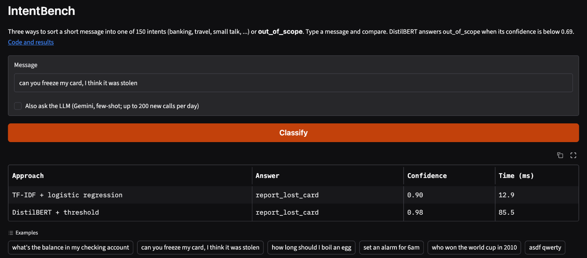
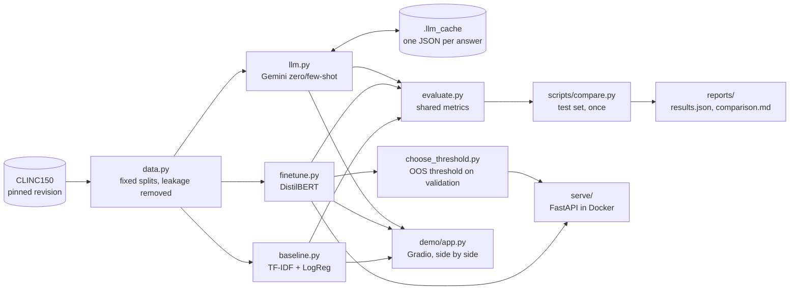

# IntentBench

**Three ways to sort short user messages into 150 intents, measured on the same data:** a TF-IDF + logistic regression baseline, a fine-tuned DistilBERT, and an LLM (Gemini, zero- and few-shot). The question it answers with evidence: *when is a simple model enough, when is a fine-tuned transformer worth it, and when should you just call an LLM?*

For engineers choosing a text classifier for a chatbot, a support inbox or a voice assistant, and for anyone who wants to see a careful, reproducible model comparison end to end.

- **Live demo:** _not deployed yet, see [Limits and next steps](#limits-and-next-steps)_
- **Results:** [reports/comparison.md](reports/comparison.md) · **Error analysis:** [reports/analysis.md](reports/analysis.md) · **Model card:** [docs/MODEL_CARD.md](docs/MODEL_CARD.md)



## Results

Held-out test set, evaluated once, after every choice was made on validation. Reproduce with `python scripts/compare.py`; full table in [reports/comparison.md](reports/comparison.md).

**All three approaches on the same 400-query test sample** (the LLM ran on a fixed sample to fit the free API quota):

| Approach | Accuracy | In-scope accuracy | Out-of-scope recall | Median latency | p95 latency | Cost / 1,000 requests |
|---|---|---|---|---|---|---|
| TF-IDF + logistic regression | 0.838 | 0.910 | 0.54 | 0.3 ms | 0.4 ms | $0 (self-hosted) |
| DistilBERT + threshold (served) | **0.910** | **0.944** | 0.77 | 12 ms | 24 ms | $0 (self-hosted) |
| LLM few-shot (Gemini 3.5 Flash-Lite) | 0.897 | 0.913 | **0.83** | 1,571 ms | 8,723 ms | $0.67 |

**Local models on the full test set** (5,500 queries, 1,000 of them out-of-scope):

| Approach | Accuracy | Macro-F1 (150 intents) | Out-of-scope precision / recall | Model size |
|---|---|---|---|---|
| TF-IDF + logistic regression | 0.843 | 0.877 | 0.91 / 0.51 | 43 MB |
| DistilBERT, no threshold | 0.892 | 0.920 | 0.98 / 0.59 | 269 MB |
| DistilBERT + threshold 0.69 (served) | **0.918** | **0.939** | 0.87 / 0.78 | 269 MB |

Latency: one request at a time on an Apple M5 CPU (local models), or the network round trip (LLM). LLM cost uses Gemini's paid-tier token price (checked 2026-10-08); the runs themselves used the free tier.

**Takeaways** (details in [reports/analysis.md](reports/analysis.md)):
- **Fine-tuned DistilBERT is the one to ship** when you have about 100 labelled examples per intent. It's the most accurate, about 130x faster than the LLM, and free per request.
- **The out-of-scope threshold matters as much as the model.** It lifts out-of-scope recall from 0.59 to 0.78 for under 1 point of in-scope accuracy.
- **The LLM is the best out-of-scope detector with zero training** (recall 0.83), but it is slower, costs money per call, and is weaker on near-identical intents.
- **TF-IDF gets within 5 points of plain DistilBERT's macro-F1** (0.877 vs 0.920) from 85 seconds of CPU training: a strong first version.

## Architecture



## Stack

| Piece | Why it's here |
|---|---|
| pandas, scikit-learn | Data handling and the TF-IDF + logistic regression baseline |
| PyTorch, Hugging Face Transformers and Datasets | Fine-tuning `distilbert-base-uncased`; loading CLINC150 at a pinned revision |
| Google Gemini (`gemini-3.5-flash-lite`) | The LLM approach; the provider sits behind one function (`llm.call_llm`), and Groq is a drop-in alternative |
| matplotlib | Loss curves, the threshold curve, accuracy by length |
| FastAPI + Pydantic v2 | The HTTP API, with request validation and auto-generated docs |
| Gradio | The side-by-side demo page, in pure Python |
| pytest, ruff, GitHub Actions | Tests, lint and formatting on every push and pull request |
| Docker | A small CPU-only image that serves the model anywhere |

## Run it locally

Requires Python 3.11+ (3.12 recommended), and about 1 GB of disk for the models and data.

```bash
git clone https://github.com/Prathameshh-Patil/intentbench.git && cd intentbench
python3.12 -m venv .venv && source .venv/bin/activate
pip install -e ".[dev]"
cp .env.example .env              # add GEMINI_API_KEY only if you want the LLM parts
```

Get the models. Either train them (about 1.5 minutes for the baseline, about 12 minutes for DistilBERT on an Apple-silicon GPU, or use `notebooks/02_finetune_on_gpu.ipynb` on a free Colab GPU):

```bash
python scripts/run_baseline.py    # -> models/baseline.joblib
python scripts/run_finetune.py    # -> models/distilbert/
```

or download the published ones, if they're available (see [docs/MODEL_CARD.md](docs/MODEL_CARD.md)).

Then, with one command each:

```bash
python demo/app.py                               # demo at http://localhost:7860
uvicorn intentbench.serve.app:app --port 8000    # API at http://localhost:8000/docs
```

### The API in Docker

```bash
docker build -t intentbench-api .
docker run -p 8000:8000 intentbench-api
```

```bash
curl -X POST localhost:8000/classify \
  -H 'Content-Type: application/json' \
  -d '{"text": "how much money is in my checking account"}'
```

```json
{"label":"balance","confidence":0.9987,"top_intents":[{"intent":"balance","confidence":0.9987},{"intent":"interest_rate","confidence":0.0003},{"intent":"transfer","confidence":0.0002}]}
```

`GET /health` and `GET /model-info` are also available. Below the out-of-scope threshold (0.69, chosen on validation), `label` is `out_of_scope`.

## Tests

```bash
pytest -q          # data, baseline, fine-tuning, LLM parsing/caching, API
ruff check . && ruff format --check .
```

CI runs both on every push and pull request.

## Reproduce the numbers

Every number in this README comes from a script in the repo:

| Command | Writes |
|---|---|
| `python -m intentbench.data` | split sizes |
| `python scripts/run_baseline.py` | `reports/baseline_validation.json` |
| `python scripts/run_finetune.py` | `reports/finetune_validation.json`, loss curves |
| `python scripts/run_llm.py --variant zero` (and `few`) | `reports/llm_gemini_*_validation.json` |
| `python scripts/choose_threshold.py` | `reports/threshold.json`, threshold curve |
| `python scripts/compare.py` | `reports/results.json`, `reports/comparison.md` (the test set, once) |
| `python scripts/analyze.py` | `reports/analysis.md` |

LLM answers are cached in `.llm_cache/`, so with the cache present a re-run makes no API calls. Without it, the LLM steps need a `GEMINI_API_KEY` and, on the free tier, two to three days of quota.

## Limits and next steps

- **The LLM was measured on 400 test queries, not 5,500**, to stay on the free tier. Its numbers have wider error bars (for example, out-of-scope recall rests on 78 queries), and macro-F1 on 400 rows (about 2 per intent) is too noisy to compare, so the sample table uses accuracy.
- **Only one LLM** (Gemini 3.5 Flash-Lite) and one prompt family were tried. A larger model or retrieval-based few-shot examples would probably do better, at a higher price.
- **Validation has 3% out-of-scope, test has 18%.** The threshold was tuned where out-of-scope is rare, so on real traffic the best threshold depends on how often users go off-topic.
- **Probabilities are over-confident** (see the Phase 3 loss curves). Calibration such as temperature scaling would make the threshold easier to reason about.
- **Not deployed yet:** Hugging Face now requires a paid plan for Gradio and Docker Spaces. The demo and API run locally with one command each; hosting is the next step.
- **Next:** calibrate, then re-pick the threshold; export to ONNX for a smaller, faster CPU image; try retrieval-based few-shot for the LLM; evaluate on a second intent dataset (for example BANKING77) to check that the conclusions generalise.

## License

MIT. Dataset: [CLINC150](https://huggingface.co/datasets/clinc/clinc_oos) (Larson et al., 2019), CC BY 3.0.
