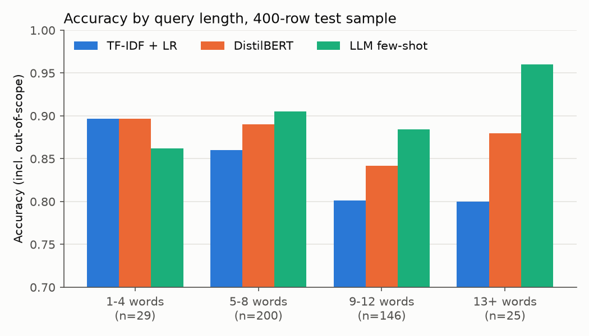

# Error analysis

Generated by `python scripts/analyze.py` from the test predictions saved by `scripts/compare.py`. TF-IDF and DistilBERT use the full test set (5500 rows) where noted; anything involving the LLM uses the 400-row sample all three were run on. DistilBERT here is the plain model (top class); the served version with an out-of-scope threshold is in `comparison.md`. `oos` is the out-of-scope label.

## Most confused intent pairs

Each row is *true intent → predicted label*, with up to three real test queries.

### TF-IDF + LR (full test set, 5500 rows)

| True intent | Predicted | Count | Examples |
|---|---|---|---|
| oos | directions | 14 | "how frequently is the bus running today" "is there a better bus route i should be taking" "is there an alternate bus stop close to my home i can use" |
| oos | travel_suggestion | 14 | "what are some things i can do on the way to work" "does centurytel offer any better plans than the one i'm on" "can you recommend some fiction books" |
| oos | find_phone | 14 | "what are the limits in my phone plan" "i need to get kalee added to my phone plan" "what is the price to buy more data on my phone" |
| oos | distance | 14 | "how would you rate the airport i am traveling to" "how long is the bank open until" "look up prices for parking at the airport over the weekend" |
| oos | recipe | 13 | "how do you make sure a bridge doesn't fall down" "how do you fix a leaking sink" "how can i use make up to cover a cut on my cheek" |
| oos | weather | 12 | "what's out at the theaters right now" "what does water taste like" "can you tell me whether the knicks will play the lakers this week" |
| oos | order | 11 | "i need a laptop with 16gb of ram" "where can i buy new shingles" "i need for you to look up some of the major gods in mythology" |
| oos | smart_home | 11 | "where can i list my vehicle for sell" "would you let me know who won the gold metal in gymnastics at the olympics" "is the stop sign around the corner still knocked over" |
| oos | income | 11 | "tell me about the earthquake in california that happened this morning" "how much money would my house sell for" "how much of a refund will i get this year" |
| oos | restaurant_reviews | 10 | "what is a good laptop for gaming" "what is a well reviewed book for a teenage girl to read" "is it ok to feed dogs people food" |

Intent-to-intent only (TF-IDF + LR), leaving out the out-of-scope rows above:

| True intent | Predicted | Count | Examples |
|---|---|---|---|
| calendar | calendar_update | 8 | "did i set march 10th as my doctor's appointment" "did i mark the mechanic's appointment on my calendar" "have i gotten around to adding the bike ride to my calendar yet" |
| redeem_rewards | rewards_balance | 8 | "how do i get stuff with visa points" "what are my mastercard points good for" "how do i use my card reward points for my next flight" |
| change_user_name | change_ai_name | 6 | "can you call me a different name" "could you call me a different name" "could you call me a different name, please" |
| rewards_balance | redeem_rewards | 5 | "i would like to check my rewards for my credit card" "i need to check my rewards for my credit card" "i need to know my credit card's rewards balance" |
| recipe | cook_time | 4 | "how do i go about cooking a 10lb turkey" "how do you prepare omelet" "how do you prepare taco" |
| directions | direct_deposit | 4 | "i want directions to phoenix" "i need some directions to phoenix" "give me directions to phoenix" |
| transactions | spending_history | 4 | "what have i spent things on" "show what i have spent things on" "how much have i spent on my debit card this month" |
| reminder | reminder_update | 4 | "what were you supposed to remind me of" "did i tell you to remind me about laundry" "what kinds of things are you supposed to remind me of" |
| todo_list | todo_list_update | 4 | "did i add "cleaning the foyer" to my todo list yet" "have i told you to add washing dishes to my todo list" "is laundry on my todo list" |
| accept_reservations | restaurant_reservation | 3 | "can i reserve tables at the new york restaurant" "is it possible to reserve a table at white castle" "do you think they'll let me reserve a table at the olive garden" |

### DistilBERT (full test set, 5500 rows)

| True intent | Predicted | Count | Examples |
|---|---|---|---|
| oos | order | 15 | "show me laptops for sale that are under $2,000" "can you look up grocery coupons for me" "where can i buy new shingles" |
| oos | mpg | 14 | "can you put the car in fuel efficient mode" "how is my driving" "how many cars average are on the road daily" |
| oos | directions | 13 | "how would you rate the airport i am traveling to" "is there a better bus route i should be taking" "is there an alternate bus stop close to my home i can use" |
| oos | smart_home | 12 | "can you dim the brightness of my screen" "park the car" "should i do a complete stop at red lights" |
| oos | sync_device | 11 | "how do i make my android phone more secure" "delete the contact uncle john from my phone" "is there a cheaper rate with another carrier for my mobile" |
| oos | text | 10 | "read text" "how many voicemail messages do i have" "what time did i get the last text message i received" |
| oos | travel_suggestion | 10 | "what are some things i can do on the way to work" "what are some of the most visited countries for people looking to travel abroad" "where's the best place to hike in the rockies" |
| oos | weather | 9 | "is the earth flat" "why is the sky blue" "when should you mow your grass after it's rained" |
| oos | shopping_list | 8 | "what stores are at my local mall" "what stores are in the local mall" "are there any sales on groceries today" |
| oos | freeze_account | 8 | "close all internet tabs" "how do i add someone to my account" "do you know if it is possible to close my savings account" |

Intent-to-intent only (DistilBERT), leaving out the out-of-scope rows above:

| True intent | Predicted | Count | Examples |
|---|---|---|---|
| redeem_rewards | rewards_balance | 7 | "how do i use my card reward points for my next flight" "i want to use my card reward points" "what are the steps to get my rewards for my visa card" |
| pin_change | change_user_name | 5 | "i would like to change the name on my checking account" "i would like to change the name on my credit card account" "i would like to change the name on my first hawaiian bank account" |
| ingredients_list | recipe | 4 | "what is needed to cook lasagna" "give me a recipe for tacos" "what's a good recipe foe tacos" |
| reminder_update | make_call | 3 | "don't forget to tell me to call my mother" "i don't want to forget to call mom" "tell me later to call bill" |
| ingredient_substitution | oil_change_how | 3 | "if i use applesauce instead of oil, will that mess it up" "is it alright to switch applesauce for oil" "will it still work if i use applesauce instead of oil" |
| payday | bill_due | 3 | "what day will i earn my payment from work" "what day can i expect to receive payment on" "when will my payment be deposited" |
| pto_used | pto_balance | 3 | "i need to know how many days i toof off" "how much pto is gone" "how much of my pto is left" |
| accept_reservations | restaurant_reservation | 3 | "can i reserve tables at the new york restaurant" "is it possible to reserve a table at white castle" "do you think they'll let me reserve a table at the olive garden" |
| restaurant_reviews | meal_suggestion | 3 | "do they serve good tacos at the buffet" "my favorite, beef tacos at the buffet" "yum, pulled pork tacos at the buffet" |
| schedule_maintenance | oil_change_when | 3 | "find out the next available date and time i can go to get my oil changed please" "can you let me know the next open slot for me to get my oil changed" "what is the next date for which i can get an oil change appointment" |

### LLM few-shot (400-row sample)

| True intent | Predicted | Count | Examples |
|---|---|---|---|
| insurance_change | insurance | 3 | "help me find a new insurance plan" "what is the protocol for getting new insurance" "let me know the process for new insurance" |
| oos | current_location | 2 | "where is te lawrence" "can you give me the gps location of harvey" |
| pin_change | oos | 2 | "i would like to change the name on my first bankcard account" "does my checking account have a pin number" |
| reminder_update | reminder | 1 | "are you able to remind me about something" |
| oos | taxes | 1 | "how much of a refund will i get this year" |
| oos | text | 1 | "please read me the last text message i received" |
| oos | todo_list_update | 1 | "create emergency phone numbers list" |
| oos | travel_suggestion | 1 | "what is the best way for dealing with the airport" |
| play_music | update_playlist | 1 | "pull up the songs under slow" |
| cancel | change_volume | 1 | "be quiet" |

## Out-of-scope errors on the 400-row sample

The sample has 78 out-of-scope queries.

| Approach | In-scope query answered `oos` (false alarm) | Out-of-scope query given an intent (missed) |
|---|---|---|
| TF-IDF + LR | 1 | 36 |
| DistilBERT | 1 | 37 |
| LLM few-shot | 7 | 13 |

## Accuracy by query length

400-row sample (all three approaches):

| Query length | rows | TF-IDF + LR | DistilBERT | LLM few-shot |
|---|---|---|---|---|
| 1-4 words | 29 | 0.897 | 0.897 | 0.862 |
| 5-8 words | 200 | 0.86 | 0.89 | 0.905 |
| 9-12 words | 146 | 0.801 | 0.842 | 0.884 |
| 13+ words | 25 | 0.8 | 0.88 | 0.96 |

Full test set (5500 rows, local models):

| Query length | rows | TF-IDF + LR | DistilBERT |
|---|---|---|---|
| 1-4 words | 515 | 0.872 | 0.903 |
| 5-8 words | 2645 | 0.85 | 0.904 |
| 9-12 words | 1798 | 0.834 | 0.874 |
| 13+ words | 542 | 0.812 | 0.884 |

## Where the approaches disagree (400-row sample)

| Which approaches are right | Rows |
|---|---|
| TF-IDF + LR + DistilBERT + LLM few-shot | 299 |
| DistilBERT + LLM few-shot | 28 |
| TF-IDF + LR + DistilBERT | 20 |
| LLM few-shot | 18 |
| none | 17 |
| TF-IDF + LR + LLM few-shot | 14 |
| DistilBERT | 2 |
| TF-IDF + LR | 2 |

Examples where exactly one approach is right (the right answer in **bold**):

| Query | True | TF-IDF + LR | DistilBERT | LLM few-shot |
|---|---|---|---|---|
| "are there any open reservations at outback tonight" | restaurant_reservation | cancel_reservation | accept_reservations | **restaurant_reservation** |
| "ya" | yes | goodbye | greeting | **yes** |
| "can you recommend thai food" | meal_suggestion | restaurant_suggestion | **meal_suggestion** | restaurant_suggestion |
| "i need to update my address" | oos | change_user_name | share_location | **oos** |
| "should i do a complete stop at red lights" | oos | cancel | smart_home | **oos** |
| "what time do i need to arrive to make it on time" | oos | time | time | **oos** |
| "does centurytel offer any better plans than the one i'm on" | oos | travel_suggestion | insurance | **oos** |
| "add mary to my phone plan, please" | oos | sync_device | sync_device | **oos** |
| "switch over to low power mode to preserve battery life" | oos | jump_start | jump_start | **oos** |
| "what is the best way for dealing with the airport" | oos | distance | **oos** | travel_suggestion |
| "what are my hours this week at work" | oos | income | income | **oos** |
| "the bus moves with tyre" | oos | directions | directions | **oos** |
| "how much sugar was in my urine this morning" | oos | income | calories | **oos** |
| "how to get the right medicine" | oos | distance | vaccines | **oos** |
| "when's the next mardi gras going to be" | oos | **oos** | next_holiday | next_holiday |

## Two failure patterns

**1. Out-of-scope queries that sit next to a real domain get pulled into it.** Almost every top
mistake of the two trained models is an out-of-scope query given an intent: "add mary to my phone
plan" becomes `sync_device`, "is there a better bus route" becomes `directions`, "park the car"
becomes `smart_home`. These queries share words and topic with an intent, and the training data
has very few out-of-scope examples (under 2% of train) to learn the boundary from. A classifier
trained only on "which of these 151" has no way to say "close, but none of them" except a low
confidence, which is why the threshold helps so much. The LLM, which reads the instruction "do
not force a match", misses far fewer (13 of 78 on the sample, against 36-37) but raises more
false alarms on real intents (7 against 1).

**2. Sibling intents that differ by one word of intent.** `insurance` vs `insurance_change`,
`reminder` vs `reminder_update`, `restaurant_reservation` vs `accept_reservations` /
`cancel_reservation`, `meal_suggestion` vs `restaurant_suggestion`. The topic is identical; only
the action (ask, change, cancel) differs, and often only implicitly ("help me find a new
insurance plan" means *change*). TF-IDF matches the topic words; DistilBERT and the LLM do better
but still trip when the action word is missing. More examples of the action phrasing, or merging
siblings into one intent plus a slot, would fix most of these.

**Also worth knowing.** Some "errors" are label noise in the dataset itself: five test queries
like "i would like to change the name on my checking account" are labelled `pin_change`, and
DistilBERT's `change_user_name` is arguably right. And length matters differently per approach:
TF-IDF gets worse as queries get longer (more words that dilute the telling ones), while the LLM
gets better (more context to reason with) and is weakest on 1-4 word queries like "ya".

## Recommendation

**Ship fine-tuned DistilBERT with the out-of-scope threshold as the default** (this is what the
API serves). On the 400-row sample it beats the LLM on accuracy (0.910 vs 0.897)
and in-scope accuracy (0.944 vs 0.913); on the full test set its macro-F1 is
0.939. It answers in about 12 ms on a laptop CPU, over 100x faster than the LLM's
1571 ms median, with no per-request fee. The threshold is what makes it shippable:
out-of-scope recall goes from 0.59 to 0.78.

- **TF-IDF + logistic regression** when there is no GPU for training, the label set changes
  often (it retrains in about a minute), or the model must be tiny and explainable: macro-F1
  0.877 on the full test set, 0.3 ms per request, 43 MB. Its weak spot is
  out-of-scope (recall 0.51): add a threshold before using it in front of users.
- **An LLM** when there is little or no labelled data, or the intents change faster than you
  can collect examples. With no training it is already close (in-scope accuracy 0.913),
  and it was the best at spotting out-of-scope queries without any tuning (recall 0.83).
  The price is latency (p95 8.7 s), a provider dependency, and $0.67 per 1,000
  requests, small per request but proportional to traffic.
- With about 100 labelled examples per intent, as here, fine-tuning a small transformer is worth
  the extra 12 minutes of training.

*Caveat on the sample:* macro-F1 on 400 rows rests on about two examples per intent, so a single
mistake can halve an intent's F1. Compare approaches on the sample by accuracy, and use the full
test set for macro-F1.
